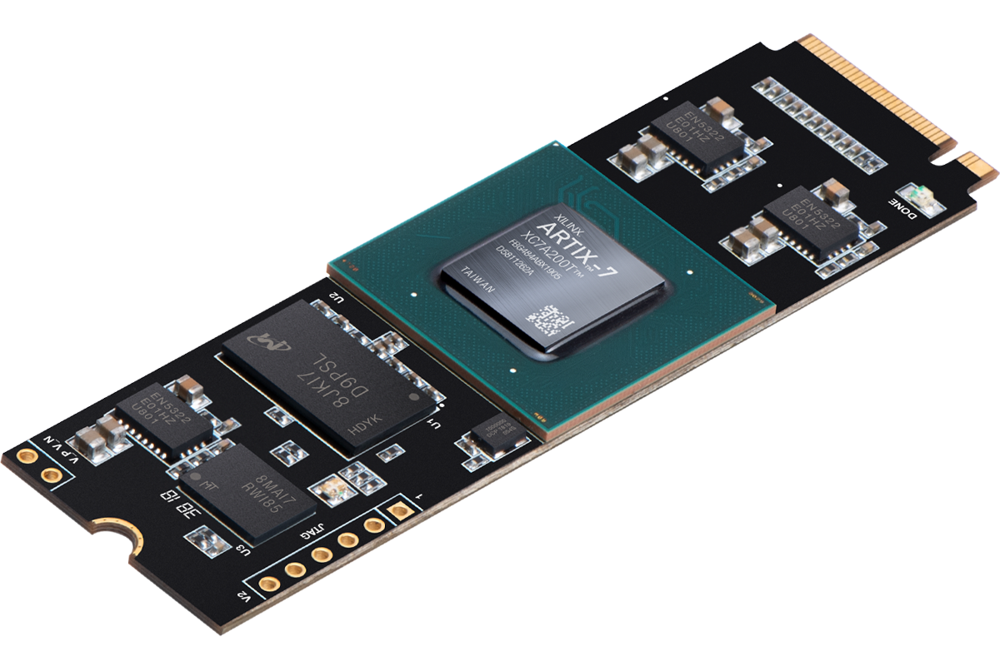

# RIFFA Artix-7 PCIe Benchmark & MSI Validation

A lightweight verification framework for evaluating PCIe throughput and MSI interrupt signaling on Xilinx Artix-7 FPGAs using the open-source RIFFA (Reusable Integration Framework for FPGA Accelerators) architecture.

---

## 1. Architecture & Features

* **High-Throughput DMA:** Maximizes PCIe link saturation via optimized Scatter-Gather buffer management.
* **MSI Interrupt Validation:** Triggers and monitors hardware-to-host Message Signaled Interrupts (MSI) during continuous data transfers.
* **Modular Layout:** Clean separation between the Linux kernel-space driver (`riffa_linux_driver`) and user-space test utilities (`riffa_linux_app`).

---

## 2. Directory Structure

```text
.
├── riffa_linux_driver/    # RIFFA kernel-space driver module
├── riffa_linux_app/       # User-space test suite and benchmark utilities
└── README.md

```

---

## 3. Prerequisites

* **Hardware:** Xilinx Artix-7 FPGA development board (e.g., AC701 / Aller A7) configured with the RIFFA 2.2.2 PCIe endpoint bitstream.
* **OS:** Linux kernel (6.8.0 tested).
* **Dependencies:** Build essentials, kernel headers matching the running kernel (`linux-headers-$(uname -r)`).

---

## 4. Hardware Platform (Aller A7) & FPGA User Logic

### 4.1. Aller A7 FPGA Board Overview

The **Aller A7** is a compact, high-performance FPGA development board built with an **M.2 (M-Key)** form factor, allowing direct host communication and power delivery through an M.2 slot.



#### Key Specifications

* **FPGA Device:** AMD Artix-7 (`XC7A200T-2FBG484I`)
* **Memory:** 2Gb DDR3 (`MT41J128M16JT-125`)
* **Bus Interface:** 4-lane PCIe Gen2 (5 GT/s)
* **Storage:** 512 Mb Quadbit SPI Flash memory
* **Clock Source:** 100 MHz CMOS oscillator
* **Security:** Trusted Platform Module (`AT97SC3205`)
* **Form Factor & Power:** M.2 M-Key interface (powered directly from the connector)
* **Debugging:** JTAG header for programming and debugging

🔗 **Reference:** [Numato Lab Aller A7 FPGA Board with M.2 Interface](https://numato.com/product/aller-artix-7-fpga-board-with-m-2-interface)

### 4.2. FPGA User Logic: RIFFA Loopback Tester (`chnl_tester`)

The `chnl_tester` module serves as the standard RIFFA User Logic implementation for the Aller A7 (Artix-7 XC7A200T) PCIe Gen2 FPGA project. It acts as a baseline hardware verification module to test DMA streaming performance, link stability, and data integrity between the host PC and the FPGA.

#### Core Architecture & FSM Design

The module implements a robust 4-state finite state machine (FSM) that manages full-duplex data streaming:

* `STATE_IDLE` (`2'd0`): Waits for the host to trigger a receive transaction (`CHNL_RX`) and latches the transfer length.
* `STATE_RX` (`2'd1`): Consumes incoming data streams from the host via continuous read-enable handshaking (`CHNL_RX_DATA_REN`) and tracks word counts.
* `STATE_PREP` (`2'd2`): A transition state that re-initializes internal counters to prepare for the transmission phase.
* `STATE_TX` (`2'd3`): Generates an incrementing test pattern (`{word_counter + 4, ...}`) and echoes it back to the host via valid/ready handshake control (`CHNL_TX_DATA_VALID & CHNL_TX_DATA_REN`).

#### Future Scalability

While currently configured as a Loopback Test template, this module is structured as the foundational framework for upcoming features. It can be easily adapted to house custom hardware accelerators, streaming operators, or digital signal processing (DSP) pipelines by swapping the internal test pattern generator with proprietary compute logic while keeping the RIFFA PCIe interface untouched.

#### Verilog Source (`chnl_tester.v`)

```verilog
module chnl_tester #(
    parameter integer C_PCI_DATA_WIDTH = 32
)
(
    // External interfaces (keeping RIFFA standard naming)
    input  wire                         CLK,
    input  wire                         RST,
    
    output wire                         CHNL_RX_CLK,        
    input  wire                         CHNL_RX,            
    output wire                         CHNL_RX_ACK,        
    input  wire                         CHNL_RX_LAST,       
    input  wire [31:0]                  CHNL_RX_LEN,        
    input  wire [30:0]                  CHNL_RX_OFF,        
    input  wire [C_PCI_DATA_WIDTH-1:0]  CHNL_RX_DATA,       
    input  wire                         CHNL_RX_DATA_VALID, 
    output wire                         CHNL_RX_DATA_REN,   

    output wire                         CHNL_TX_CLK,        
    output wire                         CHNL_TX,            
    input  wire                         CHNL_TX_ACK,        
    output wire                         CHNL_TX_LAST,       
    output wire [31:0]                  CHNL_TX_LEN,        
    output wire [30:0]                  CHNL_TX_OFF,        
    output wire [C_PCI_DATA_WIDTH-1:0]  CHNL_TX_DATA,       
    output wire                         CHNL_TX_DATA_VALID, 
    input  wire                         CHNL_TX_DATA_REN    
);

    // =========================================================================
    // FSM State Definitions
    // =========================================================================
    localparam [1:0] 
        STATE_IDLE = 2'd0, // Wait for host request
        STATE_RX   = 2'd1, // Receive data from host
        STATE_PREP = 2'd2, // Prepare for transmission
        STATE_TX   = 2'd3; // Send loopback data back to host

    // =========================================================================
    // Internal Registers
    // =========================================================================
    reg [C_PCI_DATA_WIDTH-1:0] data_register   = 0; // Holds received data / test pattern
    reg [31:0]               transfer_length = 0; // Transfer length in words
    reg [31:0]               word_counter    = 0; // Counts processed words
    reg [1:0]                fsm_state       = 0; // Current FSM state

    // ---------------------------------------------------------------------------
    // Continuous Assignments (Combinational Logic)
    // ---------------------------------------------------------------------------
    // RX channel controls
    assign CHNL_RX_CLK      = CLK;
    assign CHNL_RX_ACK      = (fsm_state == STATE_RX);
    assign CHNL_RX_DATA_REN = (fsm_state == STATE_RX);

    // TX channel controls
    assign CHNL_TX_CLK        = CLK;
    assign CHNL_TX            = (fsm_state == STATE_TX);
    assign CHNL_TX_LAST       = 1'b1;
    assign CHNL_TX_LEN        = transfer_length;
    assign CHNL_TX_OFF        = 31'd0;
    assign CHNL_TX_DATA       = data_register;
    assign CHNL_TX_DATA_VALID = (fsm_state == STATE_TX);

    // ---------------------------------------------------------------------------
    // Sequential Logic (4-State Loopback FSM)
    // ---------------------------------------------------------------------------
    always @(posedge CLK or posedge RST) begin
        if (RST) begin
            transfer_length <= 0;
            word_counter    <= 0;
            fsm_state       <= STATE_IDLE;
            data_register   <= 0;
        end 
        else begin
            case (fsm_state)
                
                // State 0: Wait for host to start RX
                STATE_IDLE: begin 
                    if (CHNL_RX) begin
                        transfer_length <= CHNL_RX_LEN; 
                        word_counter    <= 0;           
                        fsm_state       <= STATE_RX;    
                    end
                end
                
                // State 1: Receive data from host
                STATE_RX: begin 
                    if (CHNL_RX_DATA_VALID) begin
                        data_register   <= CHNL_RX_DATA;                          
                        word_counter    <= word_counter + (C_PCI_DATA_WIDTH / 32); 
                    end
                    
                    if (word_counter >= transfer_length) begin
                        fsm_state <= STATE_PREP; 
                    end
                end

                // State 2: Prepare for TX phase
                STATE_PREP: begin 
                    word_counter <= (C_PCI_DATA_WIDTH / 32); 
                    fsm_state    <= STATE_TX;                
                end

                // State 3: Send incrementing pattern back to host
                STATE_TX: begin 
                    if (CHNL_TX_DATA_REN & CHNL_TX_DATA_VALID) begin
                        data_register <= {word_counter + 4, word_counter + 3, word_counter + 2, word_counter + 1};
                        word_counter  <= word_counter + (C_PCI_DATA_WIDTH / 32); 
                        
                        if (word_counter >= transfer_length) begin
                            fsm_state <= STATE_IDLE; 
                        end
                    end
                end

            endcase
        end
    end

endmodule

```

---

## 5. Installation & Deployment

### 5.1. Build and Load the Kernel Driver

Navigate to the driver directory, compile the kernel module, and load it into the system:

```bash
cd riffa_linux_driver/
sudo make install
sudo insmod riffa.ko

```

Verify that the driver has successfully initialized and attached to the PCIe endpoint:

```bash
dmesg | grep riffa
lsmod | grep riffa

```

### 5.2. Compile the User-Space Benchmark Application

Navigate to the application directory and build the executable using the provided Makefile:

```bash
cd ../riffa_linux_app/pcie_bandwidth_test
make

```

---

## 6. Execution & Verification

### 6.1. Device Overview

Before executing the performance and functionality tests, verify that the FPGA PCIe device has been correctly recognized and enumerated by the host operating system using `lspci`:

```bash
lspci -vvs 01:00.0

```

```text
01:00.0 Memory controller: Xilinx Corporation Device 7024
        Subsystem: Xilinx Corporation Device 0007
        Control: I/O- Mem+ BusMaster+ SpecCycle- MemWINV- VGASnoop- ParErr- Stepping- SERR+ FastB2B- DisINTx-
        Status: Cap+ 66MHz- UDF- FastB2B- ParErr- DEVSEL=fast >TAbort- <TAbort- <MAbort- >SERR- <PERR- INTx-
        Latency: 0
        Interrupt: pin ? routed to IRQ 140
        IOMMU group: 1
        Region 0: Memory at e1100000 (32-bit, non-prefetchable) [size=1K]
        Capabilities: [40] Power Management version 3
                Flags: PMEClk- DSI- D1- D2- AuxCurrent=0mA PME(D0+,D1+,D2+,D3hot+,D3cold-)
                Status: D0 NoSoftRst+ PME-Enable- DSel=0 DScale=0 PME-
        Capabilities: [48] MSI: Enable+ Count=1/1 Maskable- 64bit+
                Address: 00000000fee00498  Data: 0000
        Capabilities: [60] Express (v2) Endpoint, MSI 00
                DevCap: MaxPayload 256 bytes, PhantFunc 0, Latency L0s <64ns, L1 unlimited
                        ExtTag- AttnBtn- AttnInd- PwrInd- RBE+ FLReset- SlotPowerLimit 75W
                DevCtl: CorrErr- NonFatalErr- FatalErr- UnsupReq-
                        RlxdOrd+ ExtTag- PhantFunc- AuxPwr- NoSnoop+
                        MaxPayload 256 bytes, MaxReadReq 512 bytes
                DevSta: CorrErr- NonFatalErr- FatalErr- UnsupReq- AuxPwr- TransPend-
                LnkCap: Port #0, Speed 5GT/s, Width x4, ASPM L0s, Exit Latency L0s unlimited
                        ClockPM- Surprise- LLActRep- BwNot- ASPMOptComp-
                LnkCtl: ASPM Disabled; RCB 128 bytes, Disabled- CommClk+
                        ExtSynch- ClockPM- AutWidDis- BWInt- AutBWInt-
                LnkSta: Speed 5GT/s, Width x4
                        TrErr- Train- SlotClk+ DLActive- BWMgmt- ABWMgmt-
                DevCap2: Completion Timeout: Range B, TimeoutDis- NROPrPrP- LTR-
                         10BitTagComp- 10BitTagReq- OBFF Not Supported, ExtFmt- EETLPPrefix-
                         EmergencyPowerReduction Not Supported, EmergencyPowerReductionInit-
                         FRS- TPHComp- ExtTPHComp-
                         AtomicOpsCap: 32bit- 64bit- 128bitCAS-
                DevCtl2: Completion Timeout: 50us to 50ms, TimeoutDis- LTR- 10BitTagReq- OBFF Disabled,
                         AtomicOpsCtl: ReqEn-
                LnkCtl2: Target Link Speed: 5GT/s, EnterCompliance- SpeedDis-
                         Transmit Margin: Normal Operating Range, EnterModifiedCompliance- ComplianceSOS-
                         Compliance Preset/De-emphasis: -6dB de-emphasis, 0dB preshoot
                LnkSta2: Current De-emphasis Level: -6dB, EqualizationComplete- EqualizationPhase1-
                         EqualizationPhase2- EqualizationPhase3- LinkEqualizationRequest-
                         Retimer- 2Retimers- CrosslinkRes: unsupported
        Capabilities: [100 v1] Device Serial Number 00-00-00-00-00-00-00-00
        Kernel driver in use: riffa
        Kernel modules: riffa

```

### 6.2. Bandwidth Testing

Execute the user-space application to initiate bidirectional DMA transfers and trigger hardware interrupts.

```bash
sudo ./pcie_bandwidth_test

```

```text
Number of FPGA device: 1
========== FPGA Device 0 =========
ID: 0
Number of Channels: 1
Name: 0000:01:00.00
Vendor ID: 10EE
Device ID: 7024

------------------- PCIE RIFFA DATA LOOPBACK TEST ----------------
===============================================================================================
| CH        | SIZE(B)    | TX_BANDWIDTH(MB/s) | TX_TIME(ms) | RX_BANDWIDTH(MB/s) | RX_TIME(ms) |
| 0         | 256        | 34.93              | 0.0280      | 24.39              | 0.0400      |
| 0         | 4096       | 368.42             | 0.0424      | 517.54             | 0.0302      |
| 0         | 65536      | 904.38             | 0.2764      | 809.61             | 0.3088      |
| 0         | 262144     | 1339.86            | 0.7463      | 1338.16            | 0.7473      |
| 0         | 1048576    | 1470.58            | 2.7200      | 1414.52            | 2.8278      |
| 0         | 16777216   | 1669.16            | 38.3427     | 1692.64            | 37.8108     |
-----------------------------------------------------------------------------------------------

```

### 6.3. MSI Interrupt & Single 4-Word DMA Verification

Execute a targeted user-space utility to verify small-packet transmission via a single 4-word (16 bytes) DMA transfer and confirm that the hardware successfully triggers and handles an MSI interrupt.

```bash
./raise_interrupt_test

```

```text
==========================================================
    PCIe Single DMA & MSI Test
==========================================================

[Step 1] Detecting Device & Parsing Sysfs Info...
  -> FPGA Device 0 opened successfully.
  -> PCI BDF Address    : 0000:01:00.0
  -> System IRQ Vector : 140
  -> Target CPU Core(s): CPU 0-5
  -> Initial IRQ Count : 64

[Step 2] Executing Single DMA Transfer...
  -> Sending 1 Word (4 Bytes) to Channel 0...
  -> [SUCCESS] DMA Transfer completed (1 word sent).

[Step 3] Verifying MSI Interrupt Counter...
  -> Updated IRQ Count : 65
  -> Interrupt Increment: +1

==========================================================
  [PASS] MSI Interrupt successfully triggered (+1)!
==========================================================

```

---

## 7. Performance Reference

Typical performance metrics observed on PCIe Gen2 x4 configurations:

* **Peak Read (C2H) Bandwidth:** $\approx 1.5 \text{ GB/s}$ (approaching theoretical line rate limit).
* **Peak Write (H2C) Bandwidth:** $\approx 1.4 \text{ GB/s}$.

---

## 8. License

Distributed under the MIT License. See `LICENSE` for more information.
